# Análise exploratória e pré-processamento: Titanic

Dataset Titanic: UA 1 e 2

<strong>Disciplina:</strong> Análise e Visualização de Dados 
<strong>Equipe:</strong> Diogo Galrão Carvalho; Felipe Artur Macedo Lima; Luan Cavalcante Dias Rodrigues 
<strong>Repositório:</strong> <a href="https://github.com/luang1t/hands-on-eda">github.com/luang1t/hands-on-eda</a> 
<strong>Notebook:</strong> <a href="https://github.com/luang1t/hands-on-eda/blob/main/notebooks/01_analise_titanic.ipynb">notebooks/01_analise_titanic.ipynb</a>

## 1. Introdução

A base Titanic contém 891 passageiros e 12 colunas. O notebook original do colega carregava o conjunto de Yasserh no Kaggle (YASSERH, s.d.). Nesta versão, a análise usa a cópia `data/raw/titanic.csv`, idêntica ao arquivo disponibilizado por Data Science Dojo no GitHub (DATA SCIENCE DOJO, s.d.). A versão do Kaggle consultada em 6 nov. 2026 tem os mesmos dados e a mesma ordem; os arquivos diferem apenas nas quebras de linha (CRLF e LF). O objetivo é descrever a sobrevivência, examinar relações entre variáveis e preparar uma versão numérica para análises posteriores. Os registros são uma amostra do conjunto de passageiros; as associações observadas não estabelecem causas.

## 2. Classificação e qualidade dos dados

| Variável | Tipo e subtipo | Papel e justificativa |
|---|---|---|
| `PassengerId` | Qualitativa nominal | Identificador; o número não é uma medida. |
| `Survived` | Qualitativa nominal binária | Alvo: 0 para não sobrevivente e 1 para sobrevivente. |
| `Pclass` | Qualitativa ordinal | Classe com ordem, sem distância numérica conhecida entre categorias. |
| `Name` | Qualitativa nominal | Nome de identificação, com texto individual. |
| `Sex` | Qualitativa nominal | Categoria de sexo registrada na base. |
| `Age` | Quantitativa contínua | Idade em anos, inclusive frações. |
| `SibSp` | Quantitativa discreta | Contagem de irmãos e cônjuges a bordo. |
| `Parch` | Quantitativa discreta | Contagem de pais e filhos a bordo. |
| `Ticket` | Qualitativa nominal | Código do bilhete, com alta cardinalidade. |
| `Fare` | Quantitativa contínua | Tarifa registrada. |
| `Cabin` | Qualitativa nominal | Código de cabine, com alta proporção de ausências. |
| `Embarked` | Qualitativa nominal | Porto de embarque, sem ordem entre categorias. |

Variáveis numéricas admitem medidas de posição e dispersão; categorias são resumidas por frequências. A base tem 177 idades ausentes (19,9%), 687 cabines ausentes (77,1%) e dois portos ausentes. Não há linhas integralmente duplicadas. As 15 tarifas zero foram mantidas: o registro isolado não permite determinar a causa de cada uma.

## 3. Estatística descritiva e sobrevivência

A idade tem média de 29,7 anos, mediana de 28 e varia de 0,42 a 80 anos. A tarifa tem média de 32,2, mediana de 14,45 e máximo de 512,33, com cauda à direita. `SibSp` e `Parch` têm mediana zero e máximos 8 e 6, respectivamente.

Dos 891 registros, 342 sobreviveram (38,38%) e 549 não sobreviveram (61,62%). Um classificador que sempre escolha a classe mais frequente alcançaria 61,62% de acurácia. Por isso, uma avaliação futura deve incluir matriz de confusão, precisão e revocação, além da acurácia.

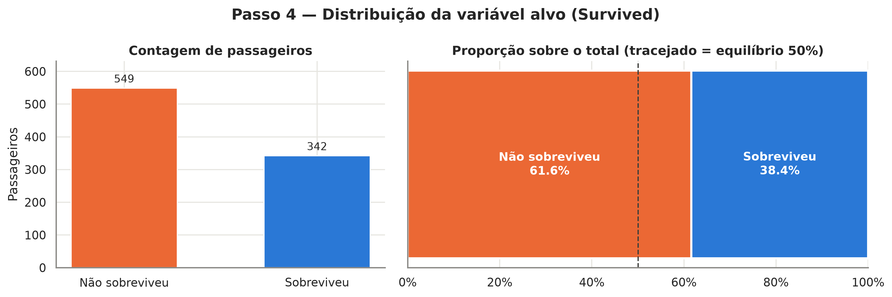

A sobrevivência foi de 74,2% entre mulheres e 18,9% entre homens. Na primeira classe foi de 63,0%, na segunda 47,3% e na terceira 24,2%. A comparação conjunta mostra 96,8% entre mulheres da primeira classe e 50,0% entre mulheres da terceira; entre homens, 36,9% e 13,5%, respectivamente. Sexo e classe estão associados ao resultado, mas os dados não isolam o efeito causal de cada variável.

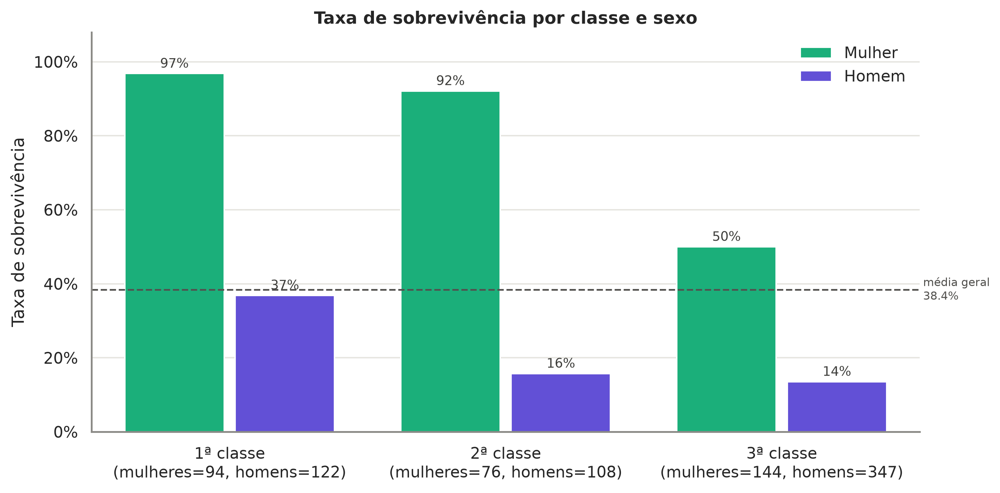

O mapa de calor resume associações lineares e deve ser interpretado junto dos gráficos de grupos. Ele não capta todas as relações não lineares nem estabelece causalidade.

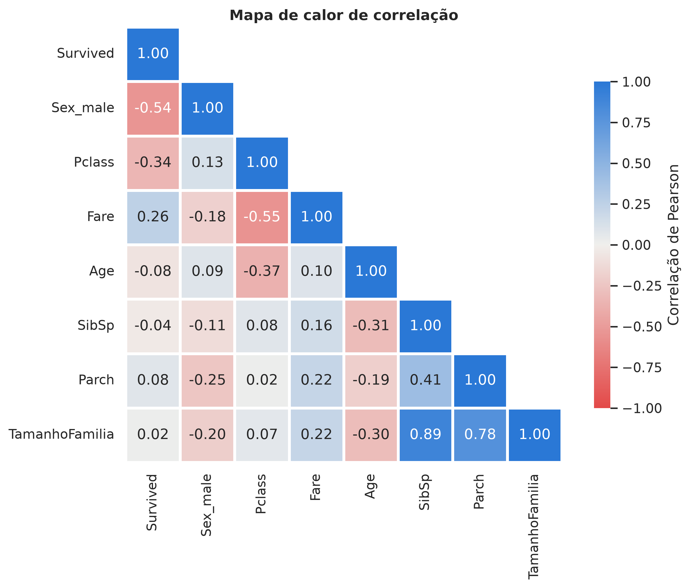

## 4. Ausências, valores extremos e transformações

Para `Age`, a mediana por sexo e classe preserva diferenças entre grupos melhor que uma mediana única, embora reduza a variabilidade; `IdadeImputada` sinaliza as 177 substituições. `Embarked` recebe a moda para duas observações. As biografias de Martha Stone e Amélie Icard registram Southampton como porto de embarque (ENCYCLOPEDIA TITANICA, s.d.a; s.d.b). `Cabin` é substituída por `TemCabine`, indicador de registro, pois imputar um código específico não teria suporte. A ausência pode refletir o processo de registro, sem comprovar que o passageiro não tinha cabine.

A regra de 1,5 intervalo interquartil sinalizou 11 valores em `Age`, 116 em `Fare`, 46 em `SibSp` e 213 em `Parch`. Em `Parch`, o intervalo interquartil é zero, então a regra sinaliza qualquer valor positivo. Valores sinalizados não são necessariamente erros. As linhas foram mantidas por não haver evidência suficiente para removê-las.

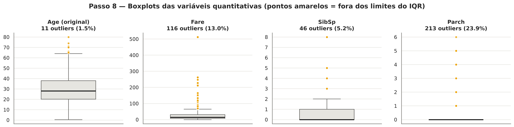

O notebook divide `Fare` pela quantidade de registros com o mesmo `Ticket` e aplica `log1p`, reduzindo a influência de tarifas altas. O resultado é uma estimativa exploratória: tarifa repetida não comprova o preço individual, e a amostra pode omitir outros ocupantes do bilhete. `SibSp` e `Parch` formam faixas de tamanho familiar. `PassengerId`, `Name`, `Ticket` e as colunas substituídas são retirados da matriz final.

`Sex`, `Embarked` e a faixa familiar recebem One-Hot Encoding, que não impõe uma ordem artificial às categorias nominais; a primeira categoria serve de referência. `Pclass` mantém a ordem. `Age` e a tarifa transformada são padronizadas por média e desvio padrão, equivalentes ao cálculo do `StandardScaler` descrito pela documentação do scikit-learn (SCIKIT-LEARN, s.d.). Essa escala ajuda modelos baseados em distância ou regularização; árvores não precisam dela.

## 5. Resultado e limites

O arquivo `data/processed/titanic_clean.csv` contém 891 linhas e 11 colunas numéricas, sem ausências. Ele descreve o processamento de toda a amostra. Para avaliação preditiva, é necessário separar treino e teste antes de ajustar imputação, categorias e escala; usar o CSV já transformado para essa avaliação causaria vazamento de informação.

<!-- titanic_metrics:start -->
<!-- titanic_metrics:end -->

## Referências

DATA SCIENCE DOJO. *titanic.csv*. Disponível em: https://raw.githubusercontent.com/datasciencedojo/datasets/master/titanic.csv. Acesso em: 6 nov. 2026.

ENCYCLOPEDIA TITANICA. *Martha M. Stone*. Disponível em: https://www.encyclopedia-titanica.org/titanic-survivor/martha-stone.html. Acesso em: 6 nov. 2026. (s.d.a).

ENCYCLOPEDIA TITANICA. *Rose Amélie Icard*. Disponível em: https://www.encyclopedia-titanica.org/titanic-survivor/amelia-icard.html. Acesso em: 6 nov. 2026. (s.d.b).

SCIKIT-LEARN. *StandardScaler*. Disponível em: https://scikit-learn.org/stable/modules/generated/sklearn.preprocessing.StandardScaler.html. Acesso em: 6 nov. 2026.

YASSERH. *Titanic Dataset*. Kaggle. Disponível em: https://www.kaggle.com/datasets/yasserh/titanic-dataset. Acesso em: 6 nov. 2026.

## Apêndice: demais gráficos do notebook

Os gráficos complementam as comparações e o tratamento descritos acima. As taxas por grupo devem ser lidas com os tamanhos das amostras; grupos menores são menos estáveis.

### Sobrevivência por categoria

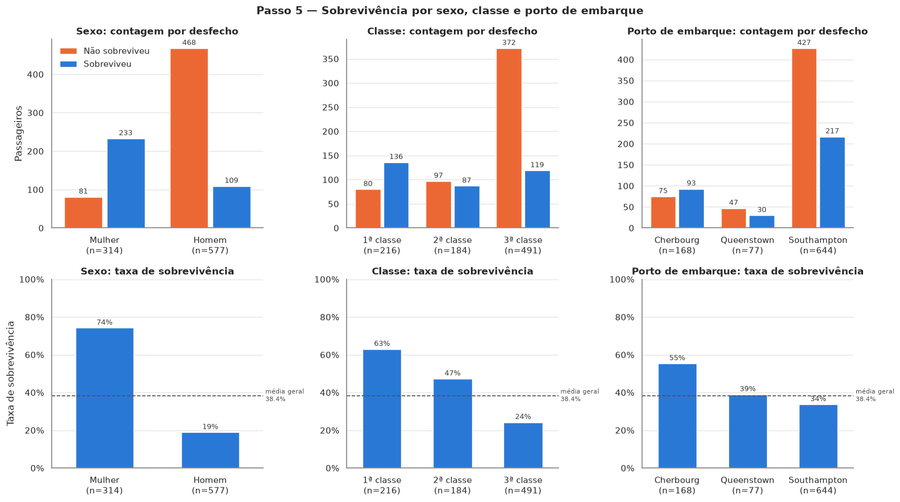

### Porto de embarque e classe

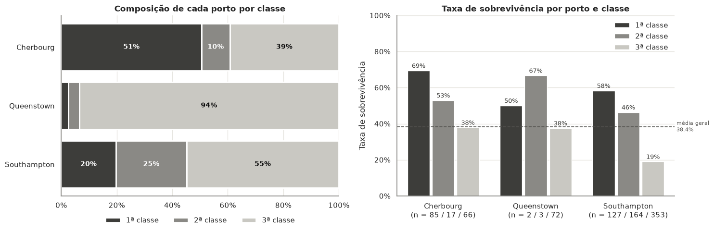

### Idade, sexo e sobrevivência

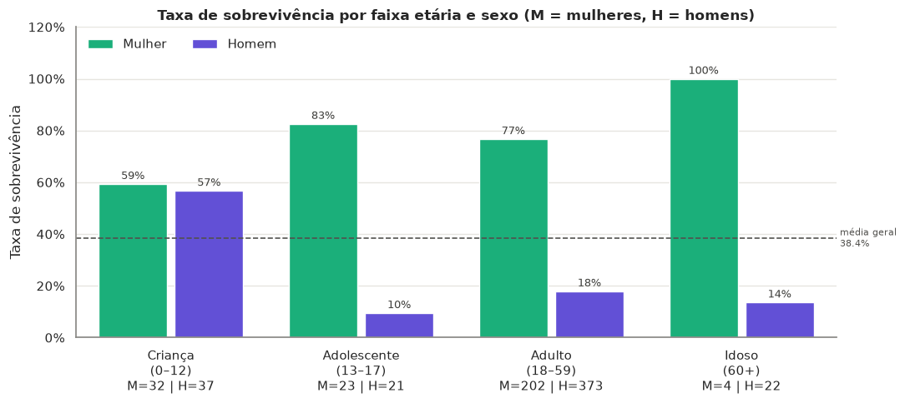

### Tamanho da família e sobrevivência

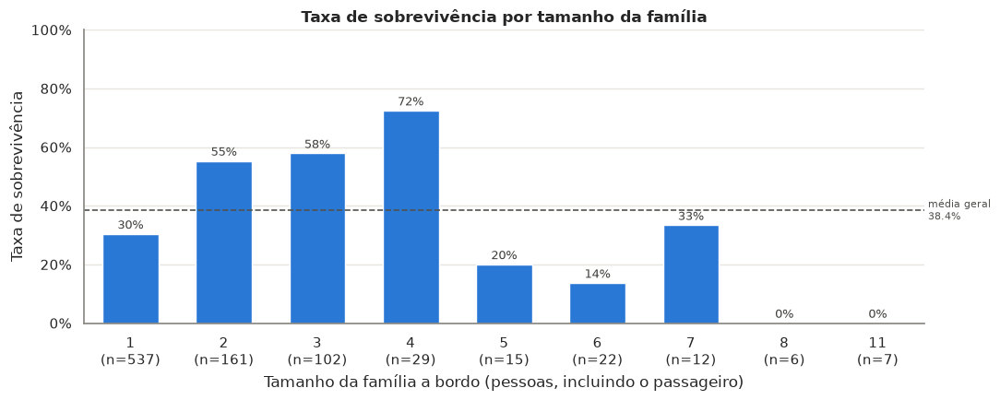

### Valores ausentes

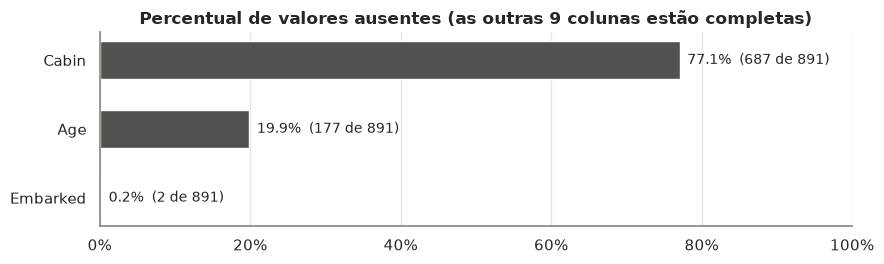

### Imputação de idade

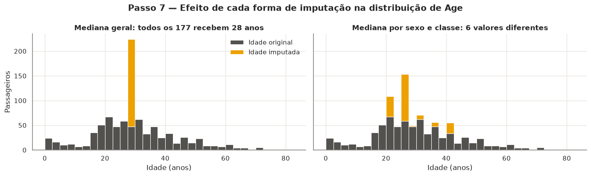

### Transformação da tarifa estimada

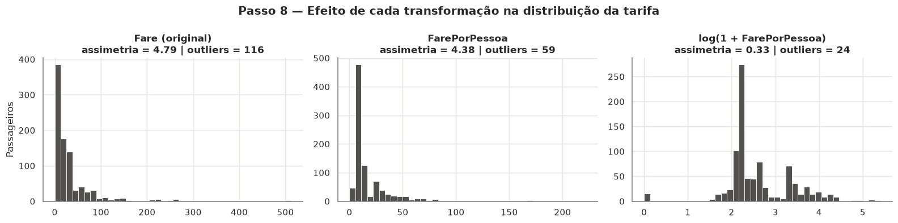

### Comparação de escalas

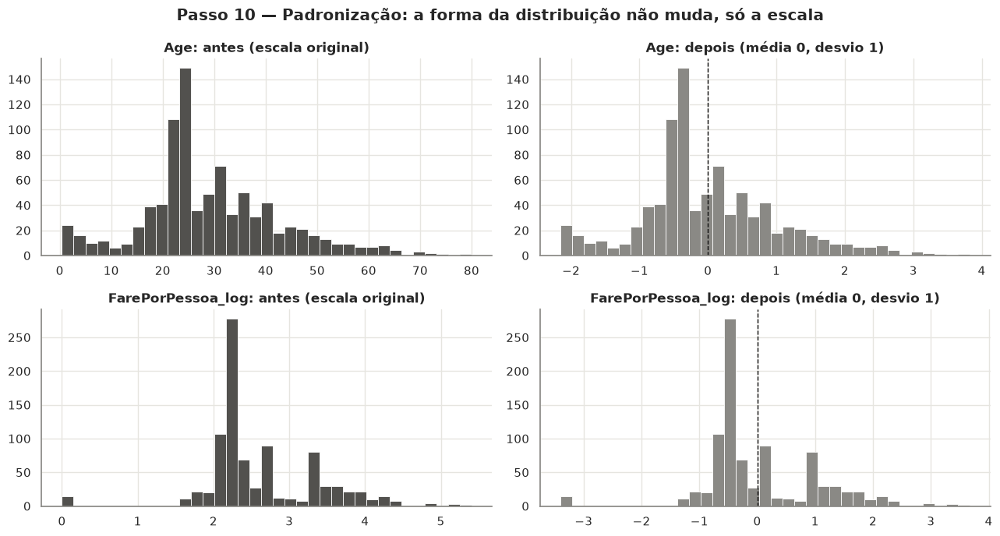
