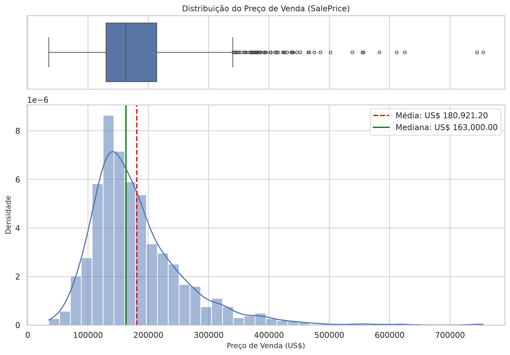
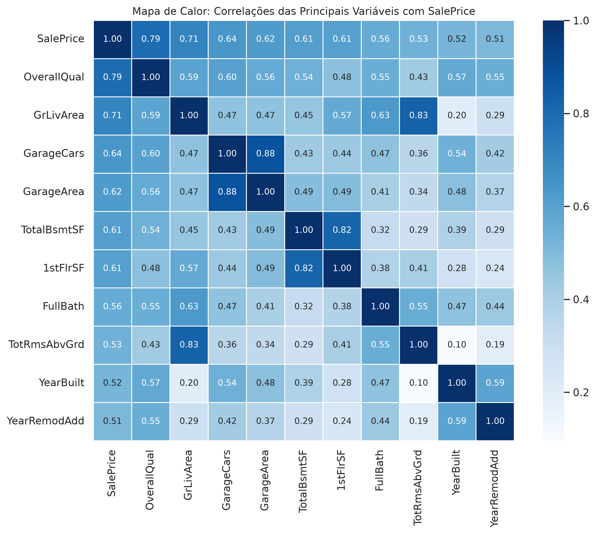
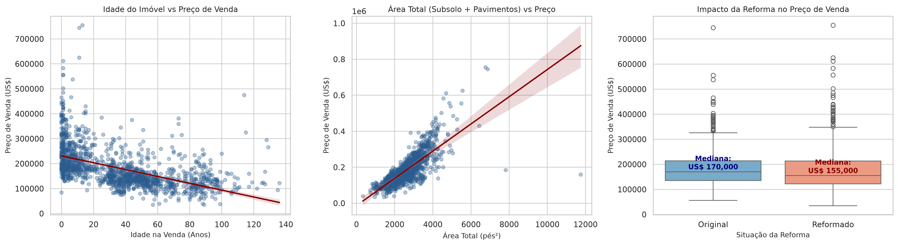
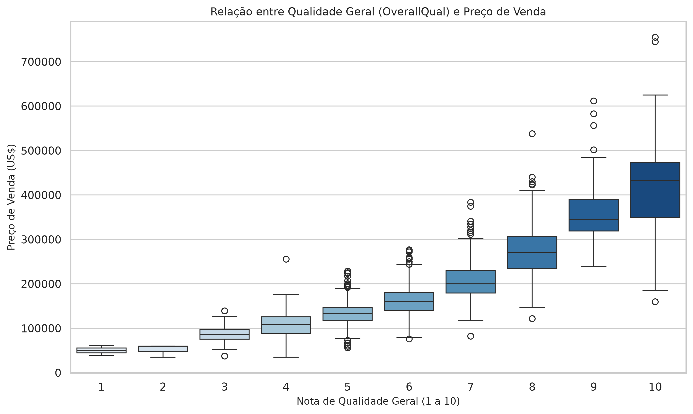
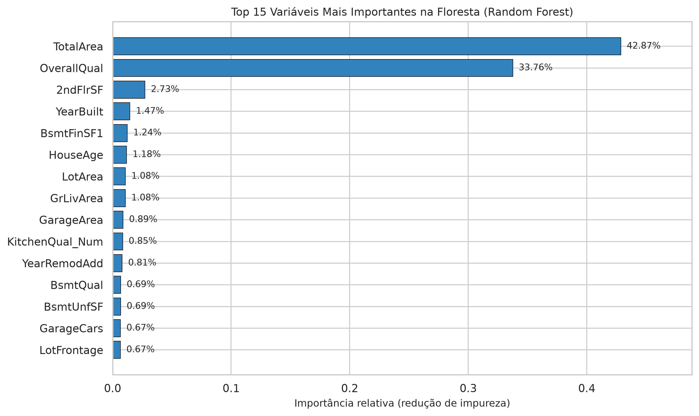
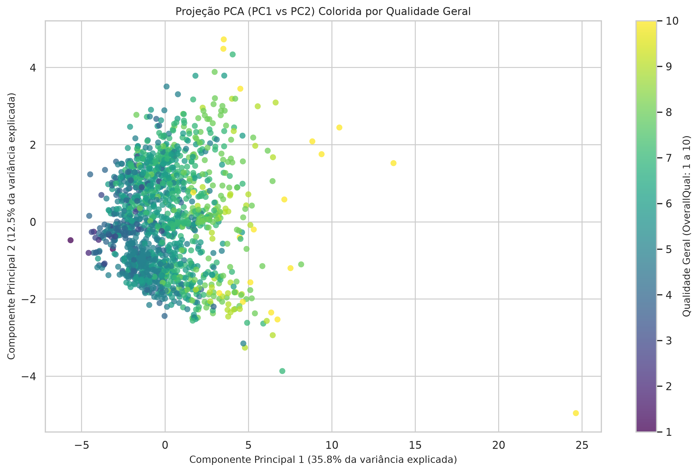

# Engenharia de recursos e visualização: House Prices

Dataset House Prices: UA 3 e 4

<strong>Disciplina:</strong> Análise e Visualização de Dados 
<strong>Equipe:</strong> Diogo Galrão Carvalho; Felipe Artur Macedo Lima; Luan Cavalcante Dias Rodrigues 
<strong>Repositório:</strong> <a href="https://github.com/luang1t/hands-on-eda">github.com/luang1t/hands-on-eda</a> 
<strong>Notebook:</strong> <a href="https://github.com/luang1t/hands-on-eda/blob/main/notebooks/02_engenharia_recursos_house_prices.ipynb">notebooks/02_engenharia_recursos_house_prices.ipynb</a>

## 1. Dados e objetivo

A cópia de treinamento House Prices usada neste trabalho foi obtida do GitHub (KRISH NAIK, s.d.) e contém 1.460 registros, 79 atributos explicativos, identificador e preço de venda. A base Ames original é descrita por De Cock (2011). A análise cria atributos, examina sua relação com `SalePrice`, compara importâncias em uma floresta aleatória e usa PCA para visualizar dimensões numéricas.

## 2. Distribuição e correlações

O preço médio é US$ 180.921,20, a mediana US$ 163.000 e o desvio padrão US$ 79.442,50. A assimetria de 1,88 indica cauda à direita: poucos preços altos elevam a média. O intervalo observado vai de US$ 34.900 a US$ 755.000.

Entre as variáveis numéricas originais, `OverallQual` tem correlação de Pearson 0,791 com o preço; `GrLivArea`, 0,709; `GarageCars`, 0,640; e `TotalBsmtSF`, 0,614. São associações lineares na amostra, não efeitos causais.

## 3. Engenharia de recursos

- `HouseAge = YrSold - YearBuilt` mede a idade na venda. A hipótese é que idade e estado do imóvel se relacionem ao preço; a correlação observada é -0,523. A idade não mede conservação diretamente.
- `TotalArea = TotalBsmtSF + 1stFlrSF + 2ndFlrSF` soma áreas dos pavimentos e do subsolo. A hipótese é que a área construída se associe ao preço; a correlação é 0,782. O total inclui subsolos que não são necessariamente habitáveis.
- `IsRemodeled` indica que o ano de reforma difere do ano de construção. O boxplot compara preços dos grupos, sem controlar idade, localização ou qualidade; não estima o retorno de uma reforma.

Os atributos derivados resumem informação já disponível. Preservar as colunas originais permite compará-las com as novas, embora a correlação entre elas dificulte atribuir importância exclusiva a uma delas.

## 4. Variáveis ordinais e ausências

`ExterQual`, `BsmtQual` e `KitchenQual` recebem códigos de 1 a 5 para preservar a ordem de qualidade; a ausência de subsolo recebe 0. A codificação ordinal é compacta, mas modelos métricos podem interpretar como iguais distâncias que não foram medidas. One-Hot Encoding evita essa suposição, ao custo de mais colunas.

`OverallQual` já é numérica e ordenada. A mediana de `SalePrice` cresce de US$ 133.000 na nota 5 para US$ 200.141 na nota 7 e US$ 345.000 na nota 9. As distribuições se sobrepõem: qualidade não explica o preço isoladamente.

Nos campos `Alley`, `PoolQC`, `Fence`, `FireplaceQu` e `GarageType`, a documentação de Ames usa ausência para indicar que o imóvel não possui o recurso (DE COCK, s.d.); o notebook cria categorias explícitas. Para o ranking, outras categorias ausentes recebem um marcador e valores numéricos recebem a mediana. O CSV exportado conserva ausências em outras colunas: ele é um conjunto enriquecido para exploração, não uma matriz inteiramente imputada. A causa de cada ausência remanescente não foi determinada.

## 5. Seleção de características

O Random Forest, implementado com scikit-learn (SCIKIT-LEARN, s.d.), usa os preditores originais e criados, excluindo `Id`. A importância das categorias codificadas é somada por variável de origem. Na amostra, `TotalArea` responde por 42,87% da redução de impureza, `OverallQual` por 33,76% e `HouseAge` por 1,18%; `IsRemodeled` tem cerca de 0,05%. A medida depende dos demais atributos presentes: áreas e qualidade correlacionadas podem dividir importância. Muitas categorias ou pontos de corte também podem favorecer um atributo.

O ranking descreve um modelo ajustado à amostra inteira; ele não demonstra efeito causal nem desempenho em imóveis novos. Para comparação preditiva, imputação, codificação e seleção devem ser ajustadas apenas nos dados de treino, com teste separado.

## 6. PCA e interpretação conjunta

O PCA foi ajustado a 14 variáveis numéricas padronizadas. PC1 explica 35,79% da variância e PC2 12,53%; juntos retêm 48,32%. A projeção mostra um gradiente de qualidade, com sobreposição entre grupos. O restante da variância não aparece no plano; as cores representam `OverallQual`, que não integra os 14 atributos usados no ajuste.

A correlação e a importância do modelo apontam uma associação entre área e preço na amostra, enquanto o PCA resume a variação das áreas sem usar o preço. Para avaliar imóveis, esses resultados sugerem comparar propriedades semelhantes considerando área, idade e qualidade. Decisões de reforma exigem também custos e dados capazes de estimar seu efeito.

<!-- house_prices_metrics:start -->
<!-- house_prices_metrics:end -->

## 7. Recomendações e conclusão

O conjunto enriquecido `data/processed/house_prices_features.csv` mantém 1.460 linhas, 89 colunas e ausências em parte das variáveis originais. `TotalArea`, `HouseAge` e `IsRemodeled` sintetizam informações existentes e podem ser testadas contra suas componentes originais. Nenhum ganho de previsão ou retorno financeiro foi medido nesta análise.

## Referências

DE COCK, Dean. *Ames, Iowa: Alternative to the Boston Housing Data as an End of Semester Regression Project*. Journal of Statistics Education, v. 19, n. 3, 2011. Disponível em: https://jse.amstat.org/v19n3/decock.pdf. Acesso em: 6 nov. 2026.

DE COCK, Dean. *Data documentation: Ames Housing*. Disponível em: https://jse.amstat.org/v19n3/decock/DataDocumentation.txt. Acesso em: 6 nov. 2026.

KRISH NAIK. *train.csv*. Advanced House Price Prediction. Disponível em: https://raw.githubusercontent.com/krishnaik06/Advanced-House-Price-Prediction-/master/train.csv. Acesso em: 6 nov. 2026.

SCIKIT-LEARN. *RandomForestRegressor*. Disponível em: https://scikit-learn.org/stable/modules/generated/sklearn.ensemble.RandomForestRegressor.html. Acesso em: 6 nov. 2026.
